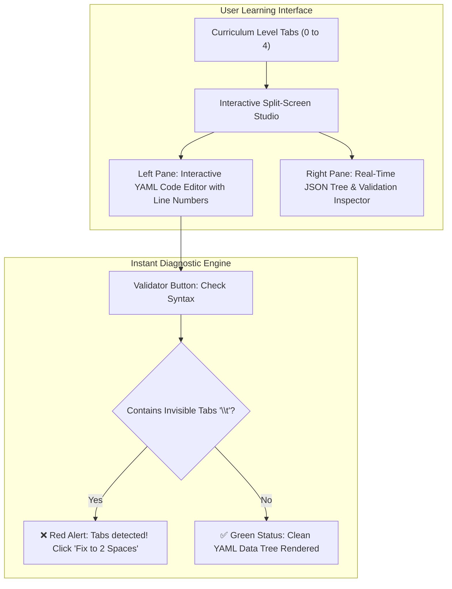

# Master YAML Curriculum & Production Ecosystem Guide
## From Absolute Beginner to Cloud & DevOps Specialist

This guide defines the architectural structure, tutorial presentation strategy, and production-grade examples for teaching YAML across the major cloud ecosystems:
1. **GitHub Actions & GitLab CI** (Pipelines & Workflows)
2. **Docker Compose** (`docker-compose.yml`)
3. **Kubernetes** (`deployment.yaml` & `service.yaml`)
4. **Ansible & Helm** (`playbook.yml` & `values.yaml`)

---

## 1. Architectural Decision: Where It Belongs

### Recommended Architecture: Hybrid Dedicated Track + CI/CD Integration
To give learners the smoothest learning curve:

1. **Dedicated Master Studio (`/devops/yaml`)**:
   - Placed under the **DevOps Dropdown** in the main navigation bar.
   - Houses the complete 5-level interactive YAML journey, live YAML ⇄ JSON visualizer, tab checker, and industry templates.
2. **Direct Prerequisite Bridge in CI/CD Studio (`/cicd`)**:
   - Add a high-visibility badge in the CI/CD Studio: *"New to YAML? Take the 5-Minute YAML Foundations Masterclass →"*.
   - Allows beginners who land on CI/CD to build confidence before writing workflow files.

---

## 2. Interactive Presentation Strategy for Users

To make YAML intuitive for someone who has never written code:



### The 5 Progressive Learning Levels:
- **Level 0 (The 2-Space Law)**: Why YAML is indentation-based, spaces vs tabs, strings, integers, and booleans.
- **Level 1 (Data Structures)**: Key-value mappings, lists (`- item`), and lists of objects.
- **Level 2 (Multiline Strings)**: Literal `|` (preserves linebreaks) vs Folded `>` (wraps text).
- **Level 3 (Reusability & DRY)**: Anchors `&`, Aliases `*`, and Merge keys `<<: *anchor`.
- **Level 4 (Cloud Ecosystem Templates)**: Real-world runnable templates for CI/CD, Docker, Kubernetes, and Helm.

---

## 3. Production-Ready Examples for All Requested Cloud Tools

### A. CI/CD Workflows: GitHub Actions & GitLab CI

#### 1. GitHub Actions (`.github/workflows/ci.yml`)
```yaml
# =========================================================================
# GitHub Actions: Automated Testing & Artifact Workflow
# Target: .github/workflows/ci.yml
# =========================================================================
name: Production CI Pipeline

# Trigger conditions
on:
  push:
    branches: [ "main" ]
  pull_request:
    branches: [ "main" ]
  workflow_dispatch:

# Restrict permissions for security
permissions:
  contents: read

jobs:
  test-and-lint:
    name: Lint, Test & Coverage
    runs-on: ubuntu-latest
    timeout-minutes: 10

    steps:
      - name: 1. Check out repository code
        uses: actions/checkout@v4

      - name: 2. Provision Python 3.12 Runtime
        uses: actions/setup-python@v5
        with:
          python-version: "3.12"
          cache: "pip"

      - name: 3. Install Dependencies
        run: |
          python -m pip install --upgrade pip
          pip install -r requirements.txt

      - name: 4. Execute Static Linting
        run: |
          ruff check .
          black --check .

      - name: 5. Run Automated Tests with Coverage
        run: |
          pytest tests/ --cov=app --cov-fail-under=80 --tb=short
```

#### 2. GitLab CI (`.gitlab-ci.yml`)
```yaml
# =========================================================================
# GitLab CI: Stage-Based Pipeline with Docker Runner
# Target: .gitlab-ci.yml
# =========================================================================
stages:
  - lint
  - test
  - build

# Default container image used by all jobs
default:
  image: python:3.12-slim

# Global cache for package wheels
cache:
  key: "${CI_COMMIT_REF_SLUG}"
  paths:
    - .cache/pip/

variables:
  PIP_CACHE_DIR: "$CI_PROJECT_DIR/.cache/pip"

# Stage 1: Lint
code-lint:
  stage: lint
  before_script:
    - pip install ruff black
  script:
    - ruff check .
    - black --check .

# Stage 2: Test
unit-tests:
  stage: test
  before_script:
    - pip install -r requirements.txt pytest pytest-cov
  script:
    - pytest tests/ --cov=app --cov-fail-under=80
  artifacts:
    when: always
    reports:
      junit: test-results.xml
```

---

### B. Docker Compose (`docker-compose.yml`)

Multi-container stack with a web service, PostgreSQL database, and Redis cache:

```yaml
# =========================================================================
# Docker Compose: Production-Style Multi-Container Application Stack
# Target: docker-compose.yml
# =========================================================================
version: "3.9"

services:
  # Web Application Service
  web:
    build:
      context: .
      dockerfile: Dockerfile
    container_name: devops_web_app
    restart: unless-stopped
    ports:
      - "8080:8080"
    environment:
      - FLASK_ENV=production
      - DATABASE_URL=postgresql://clouduser:SecurePass123@db:5432/clouddb
      - REDIS_URL=redis://cache:6379/0
    depends_on:
      db:
        condition: service_healthy
      cache:
        condition: service_started
    networks:
      - app-network

  # PostgreSQL Relational Database
  db:
    image: postgres:16-alpine
    container_name: devops_postgres
    restart: unless-stopped
    environment:
      POSTGRES_USER: clouduser
      POSTGRES_PASSWORD: SecurePass123
      POSTGRES_DB: clouddb
    volumes:
      - db_data:/var/lib/postgresql/data
    healthcheck:
      test: ["CMD-SHELL", "pg_isready -U clouduser -d clouddb"]
      interval: 5s
      timeout: 5s
      retries: 5
    networks:
      - app-network

  # Redis In-Memory Cache
  cache:
    image: redis:7-alpine
    container_name: devops_redis
    restart: unless-stopped
    ports:
      - "6379:6379"
    volumes:
      - redis_data:/data
    networks:
      - app-network

# Isolated Virtual Network
networks:
  app-network:
    driver: bridge

# Persistent Volumes
volumes:
  db_data:
    driver: local
  redis_data:
    driver: local
```

---

### C. Kubernetes Manifests: Deployment & Service

#### 1. Deployment (`deployment.yaml`)
```yaml
# =========================================================================
# Kubernetes: Declarative Pod Deployment with Health Probes & Scaling
# Target: k8s/deployment.yaml
# =========================================================================
apiVersion: apps/v1
kind: Deployment
metadata:
  name: cloud-service-deployment
  namespace: production
  labels:
    app.kubernetes.io/name: cloud-service
    app.kubernetes.io/tier: backend
spec:
  replicas: 3
  selector:
    matchLabels:
      app: cloud-service
  strategy:
    type: RollingUpdate
    rollingUpdate:
      maxSurge: 1
      maxUnavailable: 0
  template:
    metadata:
      labels:
        app: cloud-service
    spec:
      containers:
        - name: web-container
          image: ghcr.io/teachcloud/cloud_devops_service:v1.0.0
          imagePullPolicy: IfNotPresent
          ports:
            - containerPort: 8080
              name: http
          resources:
            requests:
              cpu: "100m"
              memory: "128Mi"
            limits:
              cpu: "500m"
              memory: "512Mi"
          # Liveness probe: restarts hung containers
          livenessProbe:
            httpGet:
              path: /healthz
              port: 8080
            initialDelaySeconds: 15
            periodSeconds: 10
          # Readiness probe: routes traffic only when ready
          readinessProbe:
            httpGet:
              path: /healthz
              port: 8080
            initialDelaySeconds: 5
            periodSeconds: 5
```

#### 2. Service (`service.yaml`)
```yaml
# =========================================================================
# Kubernetes: Network LoadBalancer Exposing the Deployment
# Target: k8s/service.yaml
# =========================================================================
apiVersion: v1
kind: Service
metadata:
  name: cloud-service-lb
  namespace: production
  labels:
    app: cloud-service
spec:
  type: LoadBalancer
  selector:
    app: cloud-service
  ports:
    - protocol: TCP
      port: 80
      targetPort: 8080
      name: http-traffic
```

---

### D. Ansible & Helm: Configuration & Packaging

#### 1. Ansible Playbook (`playbook.yml`)
```yaml
# =========================================================================
# Ansible: Automated Infrastructure Configuration Playbook
# Target: ansible/playbook.yml
# =========================================================================
---
- name: Provision Production Web & Security Server
  hosts: webservers
  become: true
  vars:
    app_port: 8080
    app_user: deployer

  tasks:
    - name: 1. Update APT package cache
      ansible.builtin.apt:
        update_cache: true
        cache_valid_time: 3600

    - name: 2. Install essential system dependencies
      ansible.builtin.apt:
        name:
          - python3
          - python3-pip
          - git
          - nginx
          - ufw
        state: present

    - name: 3. Ensure deployment system user exists
      ansible.builtin.user:
        name: "{{ app_user }}"
        shell: /bin/bash
        groups: sudo
        append: true

    - name: 4. Configure UFW Firewall rules
      community.general.ufw:
        rule: allow
        port: "{{ item }}"
        proto: tcp
      loop:
        - "22"
        - "80"
        - "443"

    - name: 5. Start and enable Nginx systemd service
      ansible.builtin.systemd:
        name: nginx
        state: started
        enabled: true
```

#### 2. Helm Chart Values (`values.yaml`)
```yaml
# =========================================================================
# Helm: Parameterized Cloud Application Release Configuration
# Target: charts/cloud-app/values.yaml
# =========================================================================
# Container image specification
image:
  repository: ghcr.io/teachcloud/cloud_devops_service
  tag: "v1.2.0"
  pullPolicy: IfNotPresent

# Pod replica scaling
replicaCount: 3

# Service configuration
service:
  type: ClusterIP
  port: 80
  targetPort: 8080

# Ingress domain routing
ingress:
  enabled: true
  className: nginx
  annotations:
    cert-manager.io/cluster-issuer: letsencrypt-prod
  hosts:
    - host: api.teachcloud.dev
      paths:
        - path: /
          pathType: Prefix
  tls:
    - secretName: teachcloud-tls-cert
      hosts:
        - api.teachcloud.dev

# Resource guarantees
resources:
  requests:
    cpu: 150m
    memory: 256Mi
  limits:
    cpu: 500m
    memory: 512Mi

# Autoscaling thresholds (HPA)
autoscaling:
  enabled: true
  minReplicas: 2
  maxReplicas: 10
  targetCPUUtilizationPercentage: 75
```
